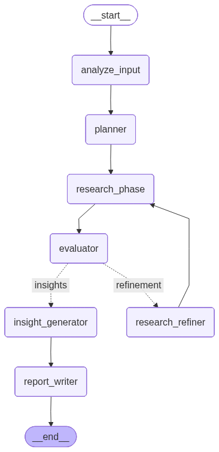

# AI Research Analyst

AI Research Analyst is an agentic research system that converts a user query into a structured research workflow. Rather than relying on a single LLM response, the system plans research tasks, gathers information from multiple sources, evaluates the collected evidence, and generates a consolidated response.

Built with LangGraph, FastAPI, Pydantic, and SQLite, the project explores workflow orchestration, parallel execution, state management, persistence, and human oversight in AI systems.

## How It Works/ Workflow


## Features

* Query understanding and refinement
* Structured task planning
* Dynamic research strategy generation
* Multi-source information gathering
* Parallel execution of research tasks
* Research aggregation and synthesis
* Quality evaluation before response generation
* Human-in-the-Loop (HITL) checkpoints
* Persistent workflow execution using SQLite and LangGraph checkpointers
* FastAPI backend for workflow interaction

## Research Sources

The system can gather information from multiple channels depending on the research objective:

* Web Search
* News Sources
* Reddit Discussions
* Research Papers

Each research task can be routed to the most appropriate source and executed independently.

## Technology Stack

* Python
* LangGraph
* LangChain
* FastAPI
* Pydantic
* SQLite

## Getting Started

```bash
git clone <repository-url>
cd AI_Research_Analyst

python -m venv env
source env/bin/activate

pip install -r requirements.txt

python app.py
```

For API execution:

```bash
uvicorn backend.main:app --reload
```

## Roadmap

* Advanced Human-in-the-Loop workflows
* Research report generation
* Reflection and self-correction loops
* Additional research providers
* Frontend interface
* Enhanced observability and tracing

## Motivation

Most LLM applications stop at prompt-response interactions. This project explores a workflow-driven approach where research is treated as a sequence of coordinated tasks involving planning, execution, evaluation, and human oversight.
